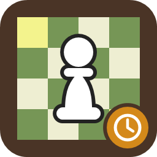

# E2e4.Chess.OpenSeal



A C# implementation of the FICS (Free Internet Chess Server) timeseal/openseal encoder: the cipher that lets a
chess client tell the server when it sent each line, so the server can compensate for network lag.

```csharp
string wire = OpenSealCipher.Encode("seek 5 0");   // wire text, ends "\x80\n"; send it as ISO-8859-1
```

Targets `net45`, `netstandard2.0`, `netstandard2.1` and `net10.0`. Install from NuGet: `E2e4.Chess.OpenSeal`.

Public API: `OpenSealCipher.Encode`, `Decode` and `TryDecode`.

## Licence

GNU General Public License, version 2 or (at your option) any later version. This code is derived from
`timeseal/openseal.c` by Marcello Mamino, distributed with FatICS; see [NOTICE](https://github.com/th3snark/E2e4.Chess.OpenSeal/blob/master/NOTICE) and [REFERENCES.md](https://github.com/th3snark/E2e4.Chess.OpenSeal/blob/master/REFERENCES.md).
An application that includes this package is distributed under the GPL.

## Layout

- `src/E2e4.Chess.OpenSeal` - the library.
- `tests/E2e4.Chess.OpenSeal.Test` - unit tests, including golden vectors from a port of `crypt()` in `openseal.c`.
- `native/MyOpenSeal` - a Win32 (WinSock) C port of openseal, kept as a reference. It needs MSBuild with a Visual Studio C++ toolset.

## Use with E2e4.Chess.Fics.Client

[E2e4.Chess](https://github.com/th3snark/E2e4.Chess)'s `E2e4.Chess.Fics.Client` takes an `ITimesealCodec`; the adapter is one line:

```csharp
sealed class OpenSealCodec : ITimesealCodec
{
    public string Encode(string line) => OpenSealCipher.Encode(line);
}
```

## Build and test

```
dotnet test E2e4.Chess.OpenSeal.slnx
```

Releases: push a `vX.Y.Z` tag and `publish.yml` tests, packs and pushes to nuget.org.
